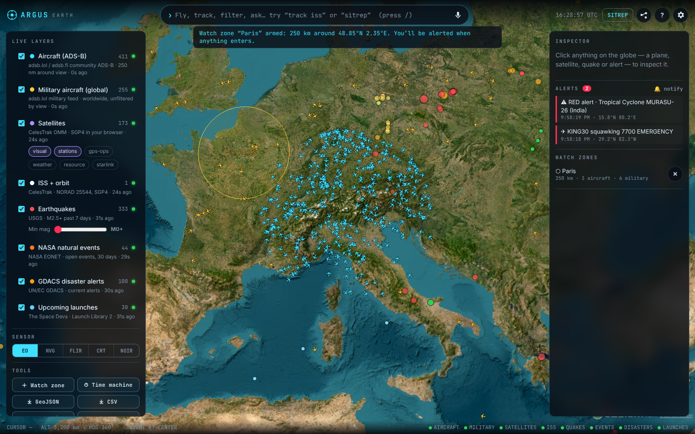

<div align="center">

# 🛰️ ARGUS Earth

### An open-source intelligence globe that runs in your browser — no install, no API keys.

Live aircraft, military flights, satellites, the ISS, earthquakes, NASA natural events, UN disaster alerts and rocket launches on a 3D globe — with **geofence watch zones, keyless voice control, satellite pass prediction and one-click situation reports.**

**[▶ Open the live app](https://mnbresearch.github.io/argus-earth/)** · [Features](#-features) · [Use cases](#-use-cases) · [Quick start](#-quick-start) · [Commands](#-command-bar--voice) · [Data sources](#-data-sources)



</div>

---

## 🌍 Why ARGUS?

Flight transponders, orbital elements, seismographs, NASA and UN alert feeds are all public. ARGUS puts them on **one explorable globe**, then adds the analyst tooling that turns "pretty dots" into **answers**: *What's inside my area right now? What just changed? When can I see it? Give me a briefing.*

> Named after **Argus Panoptes**, the hundred-eyed watchman of Greek myth. Every eye here is open data.

ARGUS is a static web app: open a URL and it works. A ~100-line optional relay unlocks live aircraft (community ADS-B APIs don't send CORS headers).

---

## ✨ Features

### Live layers (all keyless)

| Layer | Source | Refresh |
|---|---|---|
| ✈️ Aircraft (ADS-B), 250 nm around your view, dead-reckoned between polls | adsb.lol → adsb.fi fallback | 10 s |
| 🎖️ Military aircraft, worldwide | adsb.lol `/v2/mil` | 30 s |
| 🛰️ Satellites — brightest, stations, GPS, weather, Earth-observation, Starlink | CelesTrak OMM, **SGP4 propagated in your browser** | 1 s |
| ◆ ISS with live orbit ribbon | CelesTrak, NORAD 25544 | 1 s |
| 🌋 Earthquakes M2.5+ (7 days), sized by magnitude, coloured by depth | USGS | 2 min |
| 🔥 NASA natural events — wildfires, storms, volcanoes, floods, ice | NASA EONET | 10 min |
| ⚠️ Disaster alerts — Green / Orange / Red | UN/EC GDACS | 15 min |
| 🚀 Upcoming rocket launches by pad | The Space Devs Launch Library 2 | 30 min |
| ☀️ Real-time day/night terminator & atmosphere | CesiumJS | live |

### What ARGUS adds

- **⬡ Geofence watch zones** — drop a zone by clicking the globe or saying *"zone 200 km around Mumbai"*. ARGUS keeps live counts per layer and **alerts when anything new enters** (aircraft, military, quakes, hazards, disasters). Zones persist in your browser.
- **🚨 Automatic watch rules** — emergency squawks (**7500 / 7600 / 7700**), M5.5+ earthquakes, tsunami flags and GDACS **RED** alerts raise alerts automatically, with optional desktop notifications.
- **🎙️ Keyless voice + command bar** — one grammar for typing and speaking (Web Speech API, no AI key): *"track UAL123"*, *"quakes above 5"*, *"nearest wildfire"*, *"thermal"*, *"sitrep"*. Spoken replies optional.
- **📝 One-click SITREP** — a briefing for the area in view: BLUF, local time and weather, aircraft and emergencies, military contacts, seismic activity, hazards, disasters, launches, **satellites overhead right now**, overlapping watch zones, and feed-health caveats. Copy or download as Markdown.
- **☄️ Satellite pass predictor** — next passes over you (or the view centre) for 72 h: rise → set, max elevation, direction, and whether it's a **naked-eye sighting** (observer in darkness, satellite sunlit).
- **⏱ Time machine** — replay the last 7 days of global seismicity with a 3-day trailing window.
- **🎯 Click-to-inspect, double-click-to-track** — camera locks onto aircraft and satellites with per-frame SGP4 / dead-reckoned motion; satellites show their orbit.
- **🔎 Global flight lookup** — *"track AIC101"* finds a callsign anywhere through the relay, flies there and locks on.
- **🎨 Sensor modes** — NVG, FLIR (ironbow), CRT and Noir GLSL post-processing.
- **⤓ Export** everything loaded to **GeoJSON** or **CSV** for QGIS, Kepler.gl, Excel or notebooks.
- **🔗 Share links** — camera, layers, sensor mode, quake filter and tracked target serialise into the URL.
- **📊 Feed-health honesty** — every layer shows live / loading / stale / error and last update; SITREPs state degraded feeds.
- **🏙️ Optional photorealistic 3D** — add a Cesium ion token (world terrain) or Google Maps key (Photorealistic 3D Tiles) in Settings. Keys stay in your browser.
- **📱 Works on phones** — panels become drawers.

### Compared with the project that inspired it

ARGUS is an independent, from-scratch build inspired by [God's Eye View](https://github.com/bilawalsidhu/gods-eye-view) by Bilawal Sidhu. It shares no code. The focus here is **zero setup** and **analyst workflows**:

| | God's Eye View | ARGUS Earth |
|---|---|---|
| Runs from a URL, no install | — (Node app, Pinokio/Docker) | ✅ static site; relay optional |
| Voice control | ✅ realtime AI agent (OpenAI/Gemini key) | ✅ keyless Web Speech grammar |
| Geofence zones with entry alerts | — | ✅ |
| Emergency squawk / M5.5+ / GDACS red auto-alerts | — | ✅ |
| One-click SITREP briefing (Markdown) | — | ✅ |
| Naked-eye satellite pass prediction | voice pass times | ✅ with visibility model |
| UN GDACS disaster alerts, NASA EONET events | — | ✅ |
| GeoJSON / CSV export | — | ✅ |
| Codebase size | very large, many providers | ~3k lines, easy to fork |
| Cockpit view, CCTV, ships, traffic sim, 3D aircraft models | ✅ | — (see roadmap) |

---

## 🧭 Use cases

**Newsrooms & OSINT researchers** — Breaking earthquake or cyclone? Fly there, run a **SITREP**, export **GeoJSON** for the graphics desk, and drop a **watch zone** to be alerted to follow-on activity. Verify claims ("military aircraft over X") against public ADS-B in seconds.

**Disaster response & NGOs** — Arm zones around field offices or vulnerable districts. GDACS orange/red alerts, NASA wildfire and flood events and quakes inside a zone trigger alerts; share a link that opens everyone on the same view.

**Aviation enthusiasts & spotters** — Track any callsign worldwide, follow emergency squawks as they happen, and see what's overhead your home airport.

**Satellite watchers & astronomy clubs** — "When can I see the ISS tonight?" ARGUS answers with naked-eye-visible passes, direction and max elevation, then lets you ride along.

**Educators & students** — Plate boundaries light up in the 7-day **time machine**; orbital mechanics come alive with live SGP4; day/night terminator explains seasons. No accounts needed for a classroom.

**Security, logistics & risk teams** — A lightweight situational-awareness board for sites, ports and routes: zones around facilities, hazard proximity in the SITREP, CSV exports for reports.

**Developers & hackathons** — A small, readable codebase with a clean `Layer` class. Add a feed in ~40 lines (see [Adding a layer](#-adding-a-layer)).

**Content creators** — NVG / FLIR / CRT looks, share links and cinematic tracking make "God's-eye" shots without any GIS software.

---

## ⚡ Quick start

### 1 · Just open it
**https://mnbresearch.github.io/argus-earth/** — everything except aircraft works instantly. For aircraft, set a relay URL in ⚙ Settings (see option 3).

### 2 · Run locally with live aircraft (Node 18+, zero dependencies)
```bash
git clone https://github.com/mnbresearch/argus-earth.git
cd argus-earth
node server.mjs          # → http://localhost:8080  (app + ADS-B relay at /api)
```

### 3 · Host your own relay (free)
The relay forwards `/api/aircraft`, `/api/mil`, `/api/callsign/:cs` and `/api/gp` (CelesTrak cache) with CORS and short caching.

- **Vercel:** import this repo — `api/*.js` are ready-made functions; the whole app is served too.
- **Cloudflare Workers:** `npx wrangler deploy worker/cloudflare-worker.mjs --name argus-relay`, then set `https://argus-relay.<you>.workers.dev/api` in Settings.
- **Anywhere with Node:** `HOST=0.0.0.0 PORT=8080 node server.mjs`.

Or set a default for your deployment in [`js/config.js`](js/config.js).

### Tests
```bash
npm test   # geodesy, command grammar, relay routing + upstream fallback
```

---

## 🎙️ Command bar & voice

Press <kbd>/</kbd> to type or <kbd>V</kbd> to speak.

| Say or type | Does |
|---|---|
| `fly to tokyo` · `28.61, 77.21` · `geo:39.74,-104.99` | Fly anywhere (bundled places, then OpenStreetMap) |
| `track iss` · `track UAL123` · `track NOAA 19` | Lock onto a satellite or flight (global callsign lookup) |
| `show quakes` · `hide aircraft` · `military` | Toggle layers |
| `quakes above 5` · `strongest earthquake` | Filter / rank earthquakes |
| `count planes` · `nearest wildfire` · `highest plane` | Analyst answers for the current view |
| `zone 200 km around delhi` · `watch zone` | Geofence with entry alerts |
| `passes iss` · `when can i see the iss` | Pass prediction with naked-eye visibility |
| `sitrep` | Situation report for the view |
| `flir` · `nvg` · `crt` · `noir` · `normal` | Sensor modes |
| `export geojson` · `export csv` | Download loaded data |
| `time machine` · `spin` · `share` · `home` · `stop` | Replay, orbit, link, reset, release |

Keys: <kbd>/</kbd> command · <kbd>V</kbd> voice · <kbd>H</kbd> whole Earth · <kbd>?</kbd> help · <kbd>Esc</kbd> cancel.

---

## 🏗️ Architecture

```
index.html            UI shell (CesiumJS 1.145 + satellite.js 6 from jsDelivr)
js/app.js             viewer, selection/tracking, zones, alerts, commands, voice, share
js/sitrep.js          situation-report builder (+ Open-Meteo weather, Nominatim reverse geocode)
js/core/              geo math · command grammar · sensor shaders · places · utils   (pure, tested)
js/layers/base.js     Layer class: fetch loop, feed health, primitive rendering
js/layers/*.js        aircraft, satellites/ISS/passes, USGS/EONET/GDACS/launches
relay/core.mjs        shared ADS-B + CelesTrak relay (cache, fallback, validation)
server.mjs            zero-dep local server + relay
api/  worker/         the same relay for Vercel and Cloudflare Workers
tests/                node --test suite
```

Rendering uses Cesium primitive collections (points, billboards, labels) so thousands of contacts stay smooth; satellites are propagated client-side every second.

### ➕ Adding a layer
```js
import { Layer } from './base.js';
import { fetchJSON } from '../core/util.js';

export class VolcanoLayer extends Layer {
  constructor(app) { super(app, { id: 'volcanoes', name: 'Volcanoes', color: '#ff3d71', refreshMs: 3600e3, source: 'My feed' }); }
  async load() {
    const d = await fetchJSON('https://example.org/volcanoes.json');
    return d.map((v) => ({ uid: 'vo:' + v.id, kind: 'volcano', name: v.name, lat: v.lat, lon: v.lon, props: { elevationM: v.elev } }));
  }
}
```
Register it in `app.layers` — zones, alerts, SITREP, export, search and the inspector pick it up automatically.

---

## 📚 Data sources

All data is fetched live from public providers under their own terms; ARGUS bundles no datasets.

| Source | Terms |
|---|---|
| [adsb.lol](https://adsb.lol) (ODbL) · [adsb.fi](https://adsb.fi) open data | community ADS-B, non-commercial friendly; please don't hammer |
| [CelesTrak](https://celestrak.org) | free; cached 2 h per their download policy |
| [USGS Earthquake Hazards](https://earthquake.usgs.gov) | U.S. public domain |
| [NASA EONET](https://eonet.gsfc.nasa.gov) | public domain |
| [GDACS](https://www.gdacs.org) | UN/EC, attribution |
| [The Space Devs](https://thespacedevs.com) | free tier, rate-limited |
| [Open-Meteo](https://open-meteo.com) | CC BY 4.0 |
| [OpenStreetMap Nominatim](https://nominatim.org) | ODbL, usage policy |
| Esri World Imagery | Esri terms, attribution shown in app |

**Responsible use:** everything shown is public and often delayed or filtered (e.g. blocked/LADD aircraft). ARGUS is for research, education, journalism and awareness — **not** for safety-of-life decisions, targeting or harassment.

---

## 🗺️ Roadmap

- [ ] AIS ships (keyed, optional) and port congestion view
- [ ] Zone rules by type / altitude / magnitude, webhook & Telegram alerts via the relay
- [ ] Recording & replay of aircraft tracks
- [ ] LLM-written SITREP narrative (bring your own key, optional)
- [ ] PWA / offline shell

PRs welcome — keep layers keyless by default.

---

## 🙏 Credits

- Inspired by **[God's Eye View](https://github.com/bilawalsidhu/gods-eye-view)** by [Bilawal Sidhu](https://github.com/bilawalsidhu) (MIT). ARGUS is an independent implementation; no code was copied.
- Built on [CesiumJS](https://cesium.com/platform/cesiumjs/) (Apache-2.0) and [satellite.js](https://github.com/shashwatak/satellite-js) (MIT).

## 📄 License

[MIT](LICENSE) © 2026 Mridul Nanda — [MNB Research](https://github.com/mnbresearch) · Abrobot.ai. Third-party data remains under its providers' terms.
